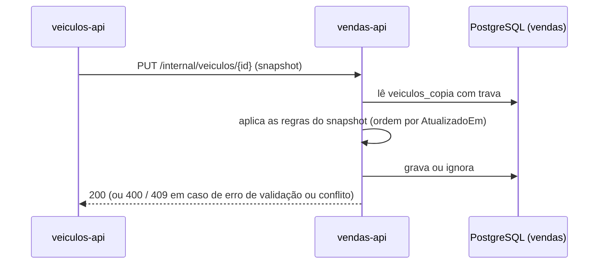

# Modelagem de dados — vendas-api

## Responsabilidade

O `vendas-api` lista os veículos à venda, lista os vendidos, efetua a venda (CPF e data) e recebe a
confirmação de pagamento por webhook. Ele **não** cadastra nem edita veículos: mantém uma **cópia local**
dos veículos, recebida do [`veiculos-api`](https://github.com/andersonnunes/veiculos-api), e tem banco de
dados próprio.

## Entidades

### `VeiculoCopia` — tabela `veiculos_copia`

| Campo | Tipo | Tamanho | Obrigatório | Regra |
|---|---|---|---|---|
| `Id` | guid | — | sim | Chave primária. É o mesmo `Id` do veículo em `veiculos-api`. |
| `Marca` | texto | 50 | sim | |
| `Modelo` | texto | 50 | sim | |
| `Ano` | inteiro | — | sim | Dentro da faixa aceita pelo domínio. |
| `Cor` | texto | 30 | sim | |
| `Preco` | decimal | 12,2 | sim | Maior que zero. Não pode ter mais de duas casas decimais. |
| `Chassi` | texto | 17 | sim | Único (`ux_veiculos_copia_chassi`). |
| `Placa` | texto | 7 | não | Única quando informada (`ux_veiculos_copia_placa`, índice parcial). |
| `Status` | texto | 20 | sim | `Disponivel`, `Reservado` ou `Vendido` (ver enum abaixo). |
| `AtualizadoEm` | data e hora com fuso | — | sim | Instante da última versão recebida de `veiculos-api`. Usado para ordenar snapshots. |

### `Venda` — tabela `vendas`

| Campo | Tipo | Tamanho | Obrigatório | Regra |
|---|---|---|---|---|
| `Id` | guid | — | sim | Chave primária, gerada pela aplicação. |
| `VeiculoId` | guid | — | sim | Chave estrangeira para `veiculos_copia`, com `RESTRICT` (a cópia não é apagada enquanto houver venda). |
| `Cpf` | texto | 11 | sim | Só dígitos, com dígitos verificadores válidos. **Armazenado em texto** (limitação conhecida). A API devolve o CPF mascarado. |
| `DataVenda` | data | — | sim | Não pode ser futura nem anterior a 30 dias. |
| `Status` | texto | 20 | sim | `Reservada`, `Concluida` ou `Cancelada` (ver enum abaixo). |
| `CodigoPagamento` | texto | 64 | sim | Único (`ux_vendas_codigo_pagamento`). É a chave que o webhook usa para localizar a venda. |
| `CriadoEm` | data e hora com fuso | — | sim | Definido na criação. |

## Enums

**`StatusVeiculoCopia`** (persistido como texto)

| Valor | Significado |
|---|---|
| `Disponivel` | À venda. Aparece na listagem pública. |
| `Reservado` | Há uma venda reservada aguardando pagamento. Sai da listagem pública. |
| `Vendido` | Venda concluída. Aparece na listagem de vendidos. |

**`StatusVenda`** (persistido como texto)

| Valor | Significado |
|---|---|
| `Reservada` | Criada, aguardando o resultado do pagamento. |
| `Concluida` | Pagamento aprovado. O veículo passa a `Vendido`. |
| `Cancelada` | Pagamento cancelado. O veículo volta a `Disponivel`. |

**Transições do veículo**

| De | Para | Gatilho |
|---|---|---|
| `Disponivel` | `Reservado` | Criação de venda (`POST /vendas`). |
| `Reservado` | `Vendido` | Webhook com `aprovado`. |
| `Reservado` | `Disponivel` | Webhook com `cancelado`. |
| qualquer | `Vendido` | Snapshot recebido com `Vendido` (ver regra abaixo). |

**Transições da venda**

| De | Para | Gatilho |
|---|---|---|
| `Reservada` | `Concluida` | Webhook com `aprovado`. |
| `Reservada` | `Cancelada` | Webhook com `cancelado`. |

Qualquer outra transição é recusada (`409`, código `transicao_invalida`). Repetir o mesmo resultado não
altera nada e responde `alterou: false`.

## Chaves, índices e concorrência

- **Chaves primárias**: `Id` em `veiculos_copia` e `vendas`.
- **Unicidade**: chassi e placa em `veiculos_copia`; código de pagamento em `vendas`.
- **Índice da listagem pública**: `ix_veiculos_copia_status_preco_id` sobre `(Status, Preco, Id)`, que atende
  o filtro por status e a ordenação por preço e id sem ordenar em memória.
- **Reserva sem corrida**: a reserva trava a linha de `veiculos_copia` (`SELECT ... FOR UPDATE`). Dois
  pedidos simultâneos para o mesmo veículo resultam em uma venda e um `409`.
- **Webhook**: a venda é localizada pelo `CodigoPagamento` e a transição é feita com a trava da venda e
  depois a do veículo, sempre nessa ordem.

## Regra do snapshot

O `veiculos-api` envia o estado completo do veículo. A `vendas-api` aplica assim:

1. Um snapshot **mais antigo** que `AtualizadoEm` é descartado.
2. Um snapshot com `Vendido` **sempre** resulta em `Vendido`.
3. Um snapshot `Disponivel` **não derruba uma reserva**: se o veículo está `Reservado`, continua `Reservado`.
4. Um snapshot `Disponivel` **reverte** um veículo `Vendido` para `Disponivel`.

O item 4 é um ponto de atenção. Na prática, o `veiculos-api` não envia `Disponivel` para um veículo
vendido, porque a edição é bloqueada depois da venda. A regra existe para o caso em que a cópia está
defasada, e está coberta por teste.

## Fronteira com a `veiculos-api`

Este serviço **recebe** os dados dos veículos e **envia** o status final das vendas.

| Direção | Rota | Conteúdo | Quando |
|---|---|---|---|
| `veiculos-api` → `vendas-api` | `PUT /internal/veiculos/{id}` | Snapshot completo do veículo. | Após cada cadastro e cada edição. |
| `vendas-api` → `veiculos-api` | `PUT /internal/veiculos/{id}/status` | `status: vendido` e `ocorridoEm`. | Quando a venda é concluída. |

Cada chamada leva token de serviço (`client_credentials`, cliente `vendas-api`). A rota `/internal` da
`veiculos-api` aceita só esse cliente.

## Fluxos

### Venda com pagamento aprovado

```mermaid
sequenceDiagram
    participant C as Cliente (vendedor)
    participant S as vendas-api
    participant B as PostgreSQL (vendas)
    participant P as Processador de pagamento
    participant V as veiculos-api

    C->>S: POST /vendas (veiculoId, cpf, dataVenda)
    S->>B: trava veiculos_copia; Disponivel → Reservado; INSERT vendas (Reservada)
    S-->>C: 201 (codigoPagamento)
    P->>S: POST /webhooks/pagamentos (aprovado, X-Assinatura)
    S->>B: Reservada → Concluida; Reservado → Vendido
    S->>V: PUT /internal/veiculos/{id}/status (vendido)
    S-->>P: 200 (alterou = true)
    Note over S,V: Se a notificação falhar, a venda continua concluída.<br/>O erro vai para o log; não há nova tentativa.
```

### Atualização da cópia



## Falhas e consistência

- **Consistência eventual com a `veiculos-api`.** Não há transação distribuída. Uma edição feita lá pode
  demorar a aparecer aqui, ou não aparecer, se a chamada falhar.
- **Sem outbox.** A notificação de venda concluída é feita diretamente. Se ela falhar, a venda fica
  `Concluida` aqui e o veículo continua `Disponivel` lá. Registrado como limitação conhecida.
- **Reserva sem expiração.** Uma venda `Reservada` que nunca recebe webhook segura o veículo
  indefinidamente. Registrado como limitação conhecida.
- **Garantias locais.** Dentro deste serviço, a reserva é exclusiva por causa da trava de linha, e o
  webhook é idempotente por causa da trava da venda.
